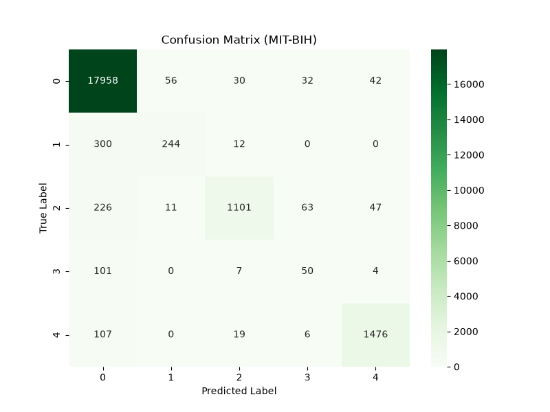

# Deep ECG lab

**95% accuracy can hide a lot.** A two-layer GRU classifies heartbeats from ECG signals. The headline number is high, but the model misses more than half of the supraventricular beats.



*TensorFlow · Keras · scikit-learn*

## What I did

- Built a two-layer GRU (64 and 32 units, dropout 0.2) for heartbeat sequences.
- Trained it on MIT-BIH for five beat classes (normal, supraventricular, ventricular, fusion, unknown) and on PTBDB for normal against abnormal.
- Saved both trained models, their confusion matrices and training curves.

## What I found

| Task | Test beats | Accuracy | Recall by class |
| --- | ---: | ---: | --- |
| MIT-BIH, five classes | 21,892 | 95.1% | normal 99% · unknown 92% · ventricular 76% · supraventricular 44% · fusion 31% |
| PTBDB, normal or abnormal | 2,911 | 85.5% | abnormal 96% · normal 59% |

- **Imbalance wins.** Normal beats are 83% of MIT-BIH, and 300 of 556 supraventricular beats are called normal.
- **Rare classes wobble.** Three training seeds agree on accuracy (95.1–95.9%), not on the rare classes: supraventricular recall moves between 37% and 49%, fusion between 31% and 59%.
- **An earlier version said 93.3% and 6%.** It had no seed and used the test set as its validation set. Validation now comes from the training data, and three seeded runs give the numbers above.
- **On PTBDB the model leans toward "abnormal".** It catches 96% of abnormal beats, but flags 41% of normal ones too. PTBDB has no patient IDs, so its split is by beat, and one patient's beats can sit in both training and test.
- What I'd try next: class weights or resampling, and reporting macro F1 beside accuracy.

## Try it

The trained models and figures are in `outputs/`, so you can look at the results without the data. To retrain, put the MIT-BIH and PTBDB CSV files in `data/`:

```text
data/mitbih_train.csv   data/mitbih_test.csv
data/ptbdb_normal.csv   data/ptbdb_abnormal.csv
```

It needs Python 3.12 or 3.13:

```powershell
py -3.13 -m venv .venv
.\.venv\Scripts\python.exe -m pip install -r requirements.txt
.\.venv\Scripts\python.exe main_mitbih.py
.\.venv\Scripts\python.exe main_ptbdb.py
```

## Layout

| Path | What's there |
| --- | --- |
| [`main_mitbih.py`](main_mitbih.py) | Five-class heartbeat model |
| [`main_ptbdb.py`](main_ptbdb.py) | Normal or abnormal model |
| [`outputs/`](outputs/) | Saved models, confusion matrices and training curves |

Deep learning course project, University of Isfahan, 2026.
