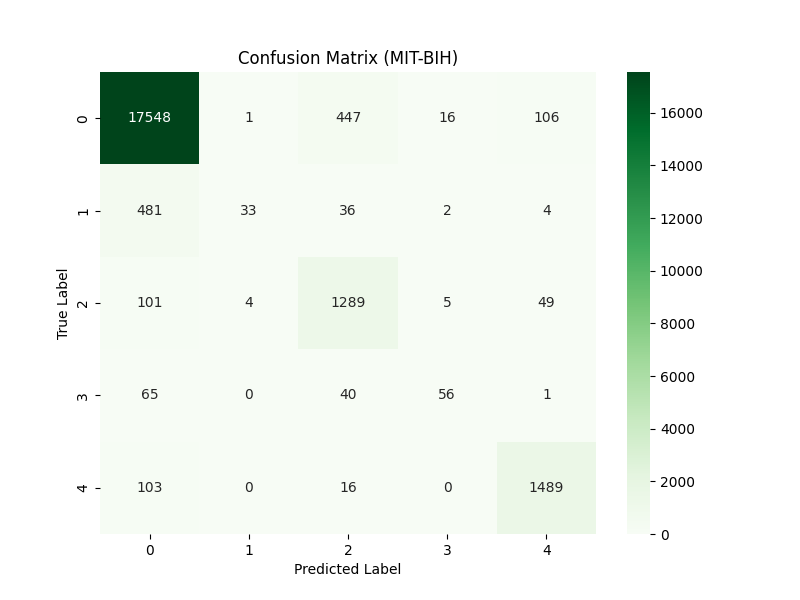
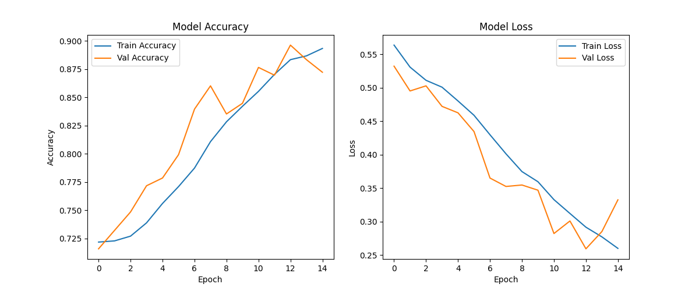

# Deep ECG Lab

An academic signal-classification project using **GRU recurrent networks** for two ECG tasks: five-class heartbeat classification on MIT-BIH and binary classification on PTBDB.

**Python · TensorFlow/Keras · pandas · NumPy · scikit-learn**

## Included work

| Task | Entry point | Saved model |
| --- | --- | --- |
| MIT-BIH: five heartbeat classes | [`main_mitbih.py`](main_mitbih.py) | `outputs/mitbih_model.h5` |
| PTBDB: normal/abnormal classification | [`main_ptbdb.py`](main_ptbdb.py) | `outputs/ptbdb_model.h5` |

The original trained models, confusion matrices and training histories are included. The figures show the completed course runs.





## Data and setup

The raw ECG CSV files remain outside this repository. Place the original course data in:

```text
data/mitbih_train.csv
data/mitbih_test.csv
data/ptbdb_normal.csv
data/ptbdb_abnormal.csv
```

From this repository directory:

```powershell
python -m venv .venv
.\.venv\Scripts\python.exe -m pip install -r requirements.txt
.\.venv\Scripts\python.exe main_mitbih.py
.\.venv\Scripts\python.exe main_ptbdb.py
```

Both entry points perform their original training and export workflows. The saved outputs can be inspected without downloading the datasets. The dependency list records the libraries imported by the scripts; no new environment lock is implied.

## Course context

Developed for deep learning coursework at the University of Isfahan. The source identifies Moeinreza Bagheri as its author. This project connects sequence modeling with the signal-processing side of the computer-engineering curriculum.
